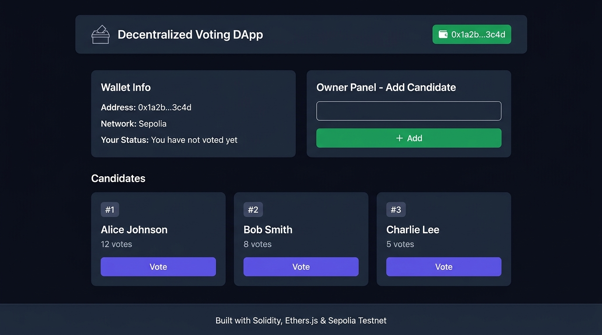

# VoteChain - Decentralized Voting DApp

A blockchain-based voting application where users can vote for candidates through a clean web interface. All votes are recorded on the Ethereum Sepolia testnet, making them transparent, tamper-proof, and verifiable by anyone.



## Features

- **Wallet Integration** - Connect your MetaMask wallet with one click
- **On-Chain Voting** - Every vote is permanently stored on the blockchain
- **One Vote Per Wallet** - The smart contract ensures each address can only vote once
- **Admin Controls** - The contract deployer can add new candidates
- **Live Results** - Vote counts update in real-time with visual progress bars
- **Network Validation** - Automatically prompts users to switch to Sepolia if needed

## Contract Details

| Field            | Value |
|------------------|-------|
| Network          | Sepolia Testnet |
| Contract Address | `0x5ef786300ADB12516801513885C193e25ec58cDd` |
| Solidity Version | ^0.8.19 |
| Etherscan        | [View on Sepolia Etherscan](https://sepolia.etherscan.io/address/0x5ef786300ADB12516801513885C193e25ec58cDd) |

## Tech Stack

- **Smart Contract** - Solidity, Hardhat
- **Frontend** - HTML, CSS, JavaScript
- **Web3** - ethers.js v6
- **Wallet** - MetaMask
- **Network** - Ethereum Sepolia Testnet

## How to Deploy the Smart Contract

1. Clone the repository:
   ```bash
   git clone https://github.com/Aadhisensei/decentralized-voting-dapp.git
   cd decentralized-voting-dapp
   ```

2. Install dependencies:
   ```bash
   npm install
   ```

3. Create a `.env` file from the template and add your credentials:
   ```bash
   cp .env.example .env
   ```
   ```env
   SEPOLIA_RPC_URL=https://ethereum-sepolia-rpc.publicnode.com
   PRIVATE_KEY=0xYOUR_PRIVATE_KEY
   ```

4. Compile the contract:
   ```bash
   npx hardhat compile
   ```

5. Deploy to Sepolia:
   ```bash
   npx hardhat run scripts/deploy.js --network sepolia
   ```

6. Copy the deployed contract address and paste it into `frontend/app.js` on line 7.

## How to Run the Frontend

No build step needed. Just open the frontend folder with any local server:

```bash
npx serve frontend
```

Then open `http://localhost:3000` in your browser.

Alternatively, you can open `frontend/index.html` directly in your browser.

### Usage

1. Click **Connect MetaMask to Start**
2. Switch to Sepolia testnet if prompted
3. If you deployed the contract, you'll see the Admin Panel to add candidates
4. Click **Cast Vote** on your preferred candidate
5. Confirm the transaction in MetaMask

## Project Structure

```
├── contracts/
│   └── Voting.sol            # Smart contract
├── scripts/
│   └── deploy.js             # Deployment script
├── frontend/
│   ├── index.html            # Main page
│   ├── app.js                # Web3 logic (ethers.js)
│   └── style.css             # Styling
├── screenshots/
│   └── dapp-ui.png           # UI screenshot
├── hardhat.config.js         # Hardhat config
├── .env.example              # Environment template
└── README.md
```

## Screenshots


## License

[MIT](LICENSE)
